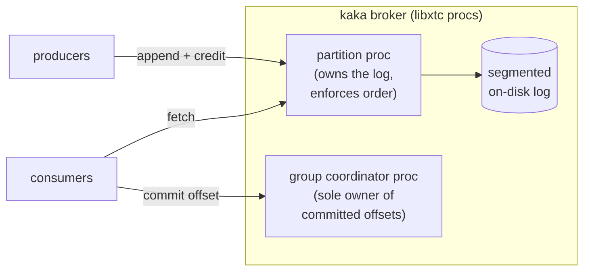

1. TOC
{:toc}

---

Source:
[`examples/07_kaka/`](https://codeberg.org/gregburd/libxtc/src/branch/main/examples/07_kaka)
(~2,800 lines of C, including tests).

## The software that inspired it

[Apache Kafka](https://kafka.apache.org/) is the canonical distributed
commit log: producers append records to **partitions** (ordered,
append-only logs), consumers read from an **offset** they track, and
**consumer groups** coordinate who reads what. Kafka is a JVM system
whose throughput comes from sequential disk I/O and the page cache;
[Redpanda](https://redpanda.com/) reimplemented the same protocol in C++
on [Seastar](https://seastar.io/) -- thread-per-core, shared-nothing,
no page cache -- to get lower and flatter latency. That Seastar lineage
is exactly the model libxtc brings to C.

`kaka` is a single-broker, partitioned log service modelled on Kafka's
data path. It is not a Kafka wire-protocol implementation; it is the
*shape* -- producers, partitions, segmented logs, consumer-group offsets
-- built to exercise the parts of libxtc the other examples do not:
sustained backpressure and per-partition ordering.

## Similar, and different



**Similar:** partitions are per-partition-ordered append-only logs;
records land in CRC-framed segment files that roll at a size threshold;
consumer groups commit offsets that survive a restart (replayed from the
durable log). This is Kafka's data model.

**Different:** each partition is a **libxtc process** that solely owns
its log, so per-partition ordering is guaranteed by single ownership
rather than by locks. The **group coordinator** is one process that owns
all committed offsets -- because it is the sole owner, offset commits
need **no lock at all**. This is the Seastar/Redpanda shared-nothing idea
expressed with lightweight processes instead of OS threads.

## How it works

- **`main.c`** -- the listener: `xtc_net_accept`, with a 10 ms back-off
  when the process is out of descriptors (the broker keeps running and
  serves again once fds free up). SIGTERM/SIGINT stop accepting and
  drain the broker.
- **`broker.c`** -- one process per connection, one per partition, and
  the routing between them. A request message carries its own copy of
  the PRODUCE payload, so a connection that gives up on a slow partition
  never leaves the partition holding a pointer into a freed buffer.
- **`partition.c`** -- the log: CRC-framed segment files that roll at a
  size threshold, an in-memory sparse offset index per segment (one
  entry per ~4 KiB, like Kafka's `.index`), optional size-based
  retention, and torn-tail truncation on restart.
- **`group.c`** -- the consumer-group coordinator process; sole owner of
  committed offsets, each commit fdatasync'ed before it is acked and
  replayed on restart. Reached through the COMMIT / OFFSETS requests.
- **`frame.c`** -- the wire codec (PROTOCOL.md).

### What an ack means

A PRODUCE ack means the records are **on disk**. The partition drains its
mailbox in batches: it appends every queued PRODUCE, issues **one**
`xtc_aio_fdatasync` for the whole batch, and only then acks each producer
(group commit -- the in-process test queues 64 produces and sees them
share one fdatasync). If the fsync fails, every produce in the batch gets
a `STORAGE` error and the partition refuses further writes (fail-stop:
after a failed fsync the kernel may have dropped the dirty pages, so
retrying would ack data that is gone). `--fsync-interval-ms=N` trades
this for throughput: acks after `write(2)`, a sync at most every N ms, so
a power failure can lose up to N ms of acked records (a broker crash
loses none -- the page cache survives it).

A PRODUCE that would exceed `--max-memory` is answered with a `MEMORY`
error and stores nothing (the batch is all-or-nothing). The budget tracks
the record bytes held in RAM right now; with a log directory the RAM copy
is only a cache, so the partition evicts it to disk before refusing.

### Reads do not stall the broker

A FETCH below the in-RAM window seeks through the segment index straight
to the record and reads with `xtc_aio_pread`, so the partition proc parks
while the kernel works and the loop keeps serving other connections. A
large fetch is built 1 MiB at a time: after each slice the partition
re-queues the rest of the request to itself and yields, so produces to
the same partition interleave with it. Measured on a 32-vCPU host (150,000
x 1 KB records, broker restarted so every read is cold): a 64 MiB FETCH
went from 8.6 s to 0.47 s, and a PRODUCE to another topic issued during
it went from 8.0 s to 1 ms.

- **Backpressure** is **credit-based**: a producer gets a bounded credit
  window and takes a credit per PRODUCE; each ack (sent only once the
  record is durable) returns one. The in-process test drives budget 4
  against 200 records and confirms peak in-flight stays at 4.

## How libxtc concepts are applied

- **Supervision.** The listener runs under the app's supervisor. The
  partition and coordinator procs are plain procs owned by the broker:
  a partition whose storage fails stays up and answers every write with
  a `STORAGE` error rather than being restarted over a disk it cannot
  trust.
- **Data sharing.** There is almost none, by design: each partition proc
  *solely owns* its log, and the coordinator *solely owns* committed
  offsets. Single ownership is the pure-message-passing ideal --
  per-partition ordering and lock-free offset commit both fall out of it,
  no shared structure required.
- **Locking.** None on the hot paths. The coordinator being the sole
  writer of offsets means the busiest coordination point in a log broker
  has no lock at all.
- **Backpressure.** Credit accounting lives in each partition proc's
  private state; a producer fiber parks when out of credit and resumes
  when credit returns -- flow control with no condition variables.

## Advantages of building it on libxtc

- **Ordering for free.** Per-partition order is a consequence of a
  single owning process, not a lock discipline you have to prove correct.
- **Lock-free offsets.** The coordinator being the sole writer means the
  hottest coordination point in a log broker -- offset commit -- has no
  contention primitive at all.
- **Backpressure is natural.** Credit accounting lives in the partition
  process's private state; the producer fiber simply parks when it is out
  of credit and resumes when credit returns -- no condition-variable
  choreography.

## Challenges (warts and all)

- **Single broker only.** Real Kafka/Redpanda are distributed with
  replication and leader election; kaka is deliberately one broker. The
  cross-node story is the subject of libxtc's distributed-module design,
  not this example -- and the docs say so rather than implying kaka is a
  cluster.
- **Segment management is real work.** Rolling, scanning for recovery,
  and truncating on a torn tail are the fiddly parts. A segment is synced
  before the next one is created, so recovery CRC-checks only the newest
  segment and truncates its torn tail; a defect in an older segment fails
  the partition open instead of silently renumbering records. The
  crash test kills the broker with SIGKILL mid-flood 20 times and checks
  every acked record is present after each restart.
- **No retention by time, no compaction.** Retention is by size only
  (`--retention-bytes`, off by default); a consumer that asks for an
  offset that has been deleted gets records from the oldest one kept.
- **Connections are not reclaimed across very long uptimes.** kaka spawns
  one proc per connection; see the runtime's KNOWN_ISSUES entry on proc
  reclamation.

## Run it

```sh
cd examples/07_kaka && make XTC_BUILD=../../build
make XTC_BUILD=../../build test     # in-process tests
./kaka-broker --dir=/tmp/kaka         # durable (fsync before ack)
./kaka-broker --dir=/tmp/kaka --fsync-interval-ms=10 --retention-bytes=1073741824
```

---

&larr; [sqlxtc (SQLite)]({{ '/examples/sqlxtc/' | relative_url }}) &middot;
Next: [tnt (Seastar / Tina)]({{ '/examples/tnt/' | relative_url }}) &rarr;
