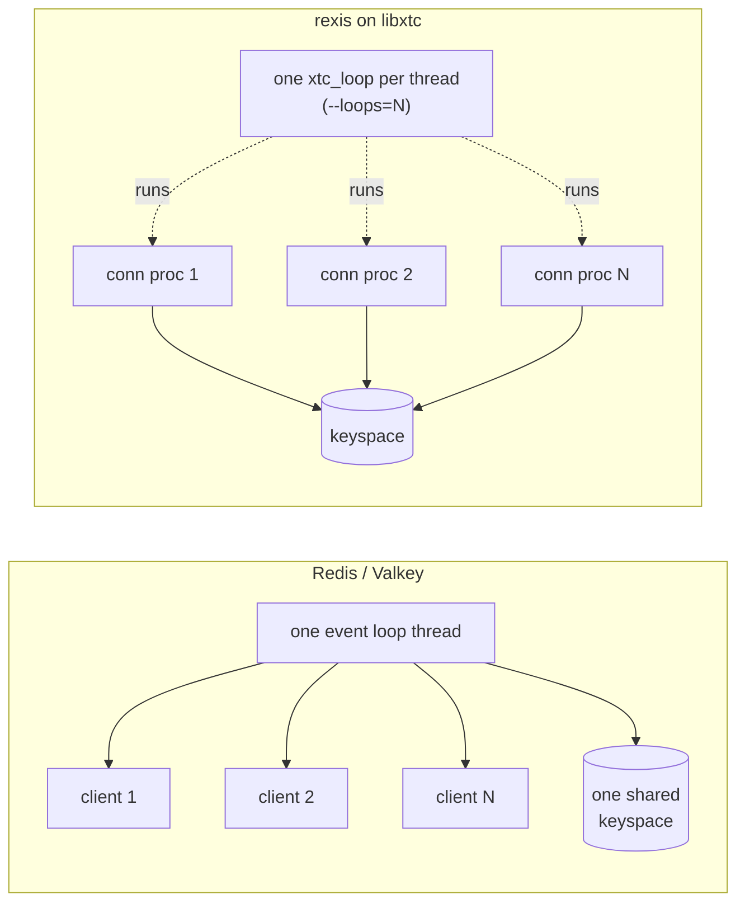

1. TOC
{:toc}

---

Source:
[`examples/05_rexis/`](https://codeberg.org/gregburd/libxtc/src/branch/main/examples/05_rexis)
(~4,500 lines of C, including tests).

## The software that inspired it

[Redis](https://redis.io/) (and its fork
[Valkey](https://valkey.io/)) is an in-memory data-structure server
spoken over the **RESP** wire protocol. Its defining architectural
choice is a **single-threaded event loop**: one thread runs an
`epoll`/`kqueue` reactor, and every command executes to completion on
that thread. That is why Redis commands are atomic without locks -- there
is only one thread. The cost is that one CPU serves all clients, and a
slow command (a big `KEYS`, a large sorted-set operation) stalls
everyone.

`rexis` is a drop-in server for a meaningful subset of Redis: you can
point `redis-cli` at it and run `SET`/`GET`/`DEL`/`EXPIRE` and friends.
It exists to answer a question: *what does Redis's model look like if
the runtime gives you cheap concurrency instead of forcing
single-threadedness?*

## Similar, and different



**Similar:** the RESP protocol, the command semantics, the in-memory
keyspace, and an optional persistent log (rexis uses a
[bitcask](https://riak.com/assets/bitcask-intro.pdf)-style append store,
Redis uses RDB/AOF).

**Different:** where Redis runs a hand-written reactor with a client
table, rexis runs **one lightweight process per connection**. Each
connection process parses its own commands and owns its own protocol
state and buffers -- there is no shared connection table to lock. By
default all of them run on ONE `xtc_loop` (one OS thread), like Redis.
`--loops=N` spreads the connection processes over the N loops of an
`xtc_exec` executor: each connection goes to the least-loaded loop, and
the keyspace, now shared by N threads, takes one parking reader/writer
latch (`xtc_arwlock`) per command, so writes are still serialized.

Spreading is also how rexis gets past a hard per-loop limit. A pid
names its process by loop and a 16-bit slot (`xtc_pid_t.local_id`), so
one loop runs at most 65,536 processes (see
[xtc_proc(3)](https://codeberg.org/gregburd/libxtc/src/branch/main/man/man3/xtc_proc.3)
and the [known issues]({{ '/reference/known-issues/' | relative_url }})).
rexis 1.59 ran one loop and stopped at 65,532 clients, closing every
later connection without a reply. Now one loop takes 65,520 clients, a
client over any limit gets Redis's `-ERR max number of clients reached`,
and `--loops=2` held 100,000 idle connections in a measurement on one
32-vCPU host.

An idle connection must also cost nothing while it waits. Each connection
process used to wake once a second to look at the shutdown flag: 100,000
idle connections then took half a core and a third of the throughput
left for the active clients. Now an idle process parks on its socket with
no deadline, and shutdown wakes each one explicitly. That costs one
`xtc_proc_wake` per connection at exit instead of 100,000 timer wakes per
second. Nor does it hold buffers it has not used: the 16 KiB query and
output buffers are allocated by the first read and the first reply, so a
connection that has sent nothing costs about 7.3 KB of RSS (15.7 KB when
both were allocated at accept; 20,000 idle connections, `--loops=2`).

## How it works

- **`main.c`** stands up an `xtc_app` with a supervised TCP listener.
- **`conn.c`** -- the listener accepts a socket and spawns one
  connection process per client (`xtc_proc_spawn`). The process loops:
  read from the socket (parking the fiber via the reactor when the
  socket is not ready), parse a RESP command, apply it, write the reply.
  The connection's teardown (close the socket, free both buffers, leave
  its pub/sub groups) is registered ONCE up front on an
  [`xtc_scope`](https://codeberg.org/gregburd/libxtc/src/branch/main/man/man3/xtc_scope.3):
  it runs on *every* exit path -- a normal close and, crucially, an
  asynchronous kill from the supervisor while the fiber is parked in
  `xtc_proc_wait_fd`. That is the "mechanism, not manner" principle in
  practice: before the scope, a kill skipped the cleanup block and
  leaked the fd and buffers; the scope closes them no matter how the
  fiber leaves. See
  [Influences and lineage]({{ '/philosophy/influences/' | relative_url }}).
- **`db.c`** holds the keyspace; **`expire.c`** handles TTLs;
  **`bitcask.c`** is the append-only persistence layer.
- **`metrics.c`** exposes counters via
  [`xtc_stats(3)`](https://codeberg.org/gregburd/libxtc/src/branch/main/man/man3/xtc_stats.3).
- Memory is bounded by one
  [`xtc_res(3)`](https://codeberg.org/gregburd/libxtc/src/branch/main/man/man3/xtc_res.3)
  budget that the keyspace AND every client's query/output buffer growth
  charge, so a client flood is *rejected* at a cap rather than driving
  the server to OOM -- something Redis controls with `maxmemory`, an
  eviction policy, and `client-output-buffer-limit`.
- **Zero-copy GET, and why the value needs a lifetime.** A GET used to
  copy the value into the connection's output buffer while it held the
  keyspace's read section. At 64 KiB that copy was 28-32% of the
  server's CPU. Sending the value's own bytes (`sendmsg` with the reply
  header, the value and the CRLF as three pieces) is easy; the hard part
  is that the send can be partial. The fiber then parks in
  `xtc_proc_wait_fd`, the read section is long gone, and a SET or DEL
  from another connection, or from a later command in the same pipeline,
  frees the value while its bytes are still queued. So a value of 4 KiB
  or more carries a reference count: the keyspace holds one, a GET reply
  takes another before it leaves the read section, and the last of the
  two to let go frees it. `xtc_rcu` was the other candidate, and it was
  rejected: an RCU read section must be short, and a slow client can
  hold a reply for seconds. A planted bug that skips the reference is
  caught by `test_rexis_loopback` and the PBT pipeline property as wrong
  bytes, and as a heap-use-after-free under ASan. Result: 64 KiB GETs
  +35%, 1 KiB unchanged.
- **Output backpressure.** A reply is built into a per-connection output
  buffer that grows up to `--max-output`; a reply that would pass it is
  replaced *whole* by an error (a truncated reply would desynchronize
  every reply after it). Once more than 1 MiB is unsent the connection
  stops reading and running commands until the client drains it, so a
  client that pipelines without reading is slowed by TCP flow control
  instead of growing the server. A command larger than `--max-request`
  is refused at its header and the connection closed (Redis
  `proto-max-bulk-len`).

## How libxtc concepts are applied

- **Supervision.** The listener runs under a supervisor; a connection
  proc that crashes on a malformed command is contained and reaped
  without touching other clients or the keyspace.
- **Data sharing.** Connection state (parse buffer, in-flight command) is
  private to each conn proc -- shared-nothing. The keyspace is the one
  deliberately shared structure; rexis keeps its sharing model simple and
  explicit rather than smearing locks across the code.
- **Locking.** Because each connection is its own proc, there is no
  shared connection table to lock -- the most common lock in a
  hand-rolled C server simply does not exist here.
- **Resource limits.** `xtc_res` caps bound memory so a client flood is
  rejected at the cap instead of OOMing -- the property Redis approximates
  with `maxmemory` + eviction.

## Advantages of building it on libxtc

- **Concurrency without a lock graph.** Each connection's state is
  private to its process, so the parser, the buffers, and the in-flight
  command have exactly one owner. There is no shared connection registry
  to protect.
- **A path to more cores** without turning atomic-by-single-thread into
  a lock nightmare: the keyspace is the one shared structure, and it can
  be guarded by a single primitive (or sharded) rather than by ad-hoc
  locking spread across the codebase. rexis itself still runs one loop;
  spreading the connection processes over an executor is the step not
  taken.
- **Backpressure and budgets are first-class** (`xtc_res`), not bolted
  on.

## Challenges (warts and all)

- **The shared keyspace is the real concurrency question.** Redis dodges
  it by being single-threaded; rexis has to decide how concurrent
  connection processes see the keyspace. The example keeps this simple
  (a single owning structure) rather than pretending it solved
  distributed sharding -- see the code for exactly where the line is
  drawn, and
  [rexis vs DragonFly and Valkey]({{ '/examples/rexis-vs-dragonfly/' | relative_url }})
  for the shard-per-loop design that would take it to many cores.
- **A table that does not grow is a time bomb.** Until 2026-10 the
  keyspace was a fixed 65,536-bucket chained hash and the persistence
  index a fixed 4,096: fine in every test, 40% of pipelined throughput
  lost at 1M keys, and a 5M-key load that slowed to a crawl. Both are
  now linear hashes (`lhash.h`) that split one bucket per insert.
- **RESP is deceptively fiddly** (inline vs. multibulk, partial reads
  across socket boundaries); the parser has to resume cleanly when a
  command spans two `read`s, which is exactly the kind of state that
  fibers keep on the stack instead of in a hand-rolled parser context.
- **Buffers are where a server dies.** The 1.55 review found every
  version of this mistake in rexis at once: a reply bigger than the
  write buffer went out as a bare header, a slow reader got a corrupted
  stream, LRANGE/KEYS silently stopped at 1024 elements, a client
  holding a large partial command pinned a core (and kept it pinned
  after hanging up), and `--max-memory` did not count client buffers at
  all (300 clients took a 10 MB-capped server to 314 MB). The fixes --
  a growable output buffer with a hard limit, read-side backpressure, a
  request-size cap enforced at the header, EOF tracked separately from
  errors, and client buffers charged to the same budget -- are each a
  few lines; finding that they were missing took an adversarial client.
  `test/m99/test_rexis_budgets.c` now measures each one.

## Run it

```sh
cd examples/05_rexis && make XTC_BUILD=../../build
./rexis-server-xtc &            # listens on the RESP port (6379)
redis-cli set hello world
redis-cli get hello             # -> "world"
```

---

Next: [sqlxtc (SQLite)]({{ '/examples/sqlxtc/' | relative_url }}) &rarr;
