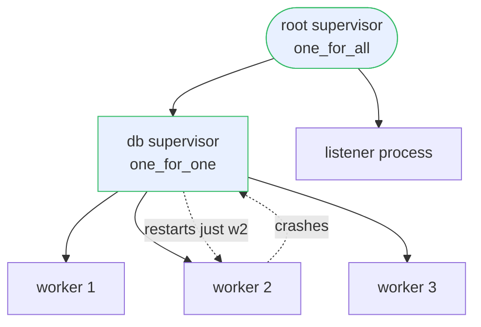

1. TOC
{:toc}

---

Processes fail. A worker hits a bad input, dereferences something it
should not, or is asked to stop. The Erlang insight libxtc adopts is:
**do not try to prevent every failure inside the process; contain it,
detect it, and recover at a higher level.** Three mechanisms make that
possible -- links, monitors, and supervisors.

## Monitors: tell me when it ends

A **monitor** is a one-way "notify me when that process ends" relation.
When the monitored process exits -- cleanly, by `xtc_exit_self`, or via a
contained fault -- libxtc delivers a **DOWN** message to the monitoring
process's mailbox. The watcher stays alive regardless of how the target
ended; it just learns about it.



```
worker: exiting with reason 42
parent: child ended, reason 42
```

Two details matter:

- **Spawn and monitor atomically.** `xtc_proc_spawn_monitor` arms the
  monitor *before* the child can run, so there is no window where a
  fast-exiting child ends before you were watching. (A plain
  `xtc_proc_spawn` followed by `xtc_monitor` has that race; the atomic
  form closes it.)
- **A DOWN is an ordinary message.** It lands in the mailbox like any
  other; `xtc_down_decode` tells you whether a received message *is* a
  DOWN and unpacks the target pid and reason. For embedders that need to
  distinguish an app exit code `1` from signal `1`,
  [`xtc_down_decode_ex`](https://codeberg.org/gregburd/libxtc/src/branch/main/man/man3/xtc_proc.3)
  fills a struct with the kind, signal, and exit code in separate
  fields.

## Links: fail together

A **link** is a *bidirectional* relation: if either linked process dies
abnormally, the other is sent an exit signal too (by default, it dies as
well). Links are how you tie together a set of processes that only make
sense as a unit -- if one collapses, the whole group should unwind
rather than limp on half-alive. `xtc_link` / `xtc_unlink` manage links;
`xtc_proc_spawn_link` spawns-and-links atomically, the same
race-free pattern as the monitor form.

{: .rationale }
> **Monitor or link?** Use a **monitor** when the watcher should survive
> and *react* to the target's death (a supervisor watching workers). Use
> a **link** when two processes share a fate and neither is meaningful
> without the other (a connection process and its dedicated codec
> process). Monitors are observational; links are structural.

## Supervisors: recovery as policy

A **supervisor** is a process whose only job is to start a set of child
processes, monitor them, and restart them according to a **strategy**
when they die. You describe the children and the policy; the supervisor
runs the "let it crash, then recover" loop for you.



When `worker 2` crashes, its `one_for_one` supervisor restarts only that
child. Had the supervisor been `one_for_all`, all three workers would
restart together. A crash the `db` supervisor cannot contain (its
restart budget is exhausted) escalates to the root supervisor.

libxtc's `xtc_sup_*` API
([`xtc_supervisor(3)`](https://codeberg.org/gregburd/libxtc/src/branch/main/man/man3/xtc_supervisor.3))
offers the classic OTP strategies:

- **one-for-one** -- restart just the child that died.
- **one-for-all** -- if any child dies, restart them all (for children
  whose states are interdependent).
- **rest-for-one** -- restart the dead child and everything started
  after it.
- **simple-one-for-one** -- a dynamic pool of identical children.

A restart budget (max restarts within a window) prevents a
crash-restart-crash storm: exceed it and the supervisor itself gives up
and escalates to *its* supervisor. This is the tree that makes BEAM
systems self-heal, and
[`examples/03_supervised_app.c`](https://codeberg.org/gregburd/libxtc-examples/src/branch/main/03_supervised_app.c)
shows a whole application built as one -- walked through in the
[Examples]({{ '/examples/' | relative_url }}) section. That example also
demonstrates the three tools a *supervised* worker needs so a restart
cannot corrupt or leak: an
[`xtc_scope`](https://codeberg.org/gregburd/libxtc/src/branch/main/man/man3/xtc_scope.3)
whose finalizer frees the worker's scratch resource on every exit path
(including the restart-kill), an
[`xtc_uncancelable`](https://codeberg.org/gregburd/libxtc/src/branch/main/man/man3/xtc_scope.3)
region around a two-step update so a kill cannot split it, and
[`xtc_trace_causal_enable`](https://codeberg.org/gregburd/libxtc/src/branch/main/man/man3/xtc_trace.3)
so a fault dump shows how the worker got to where it crashed.

### Servers and supervisors as children

A child spec names a process body, so any of these can be a child: a
plain function, a gen_server, or another supervisor. Name
`xtc_svr_child_main` as the body and an `xtc_svr_child_t` (callbacks and
state) as its argument, and the child process *is* the server: a crash
restarts it, a drain reaches its `handle_info`, and there is no server
handle to join. Name `xtc_sup_child_main` with an `xtc_sup_child_t` and
the child is a nested supervisor with its own strategy and restart
budget: the failures it can absorb stay inside it, and when its budget is
spent it exits with `XTC_E_RESOURCE`, which its parent treats like any
other crashed child. That is the escalation in the tree above.

`wait_children` makes a supervisor start its children in order, each
once the one before it is up: a server child is up when its `init` has
returned, a nested supervisor when its own children are. The start then
returns the first failure (`init`'s code) instead of `XTC_OK`, so a
dependent child never starts against a server that did not.



The `kv` server answers by name through the registry the root names its
children in, and the pool's three crashes per run stay inside the pool
until its budget is gone; the root restarts the pool once, and when the
second run spends its budget too, the root's own budget is gone and it
stops.

{: .not_chosen }
> **A keeper process per server.** Before 2.2 a supervised gen_server
> needed a plain child that started the server, linked to it and
> mirrored its exits, so a restart took two spawns and an extra fiber
> stack, and a drain never reached the server. With the server as the
> child there is nothing in between.

{: .not_chosen }
> **Defensive error handling everywhere.** The alternative to
> supervision is to make every function check and recover from every
> error locally -- the code becomes mostly error handling, and a state
> that gets corrupted anyway (the case you did not foresee) has no clean
> recovery. "Let it crash" says: write the happy path clearly, contain
> the failure to one process, and put the recovery logic in *one* place
> -- the supervisor -- where it can restart from a known-good state.
> It is less code and it recovers from the unforeseen, not just the
> foreseen.

## What you have learned

- A **monitor** notifies you (via a DOWN message) when a process ends;
  the watcher survives.
- A **link** binds two processes to a shared fate.
- A **supervisor** restarts children by policy, with a restart budget
  that escalates rather than thrashes.
- Prefer the atomic `spawn_monitor` / `spawn_link` forms to avoid the
  spawn-then-relate race.

You now have the whole process model: spawn, message, and supervise. The
last guide chapter is about the outside world -- files, sockets, and
blocking C libraries -- without giving up the single-threaded-loop
simplicity: [Blocking work and I/O]({{ '/guide/05-blocking-and-io/' | relative_url }}).

---

&larr; [Processes and messages]({{ '/guide/03-processes-and-messages/' | relative_url }}) &middot;
Next: [Blocking work and I/O]({{ '/guide/05-blocking-and-io/' | relative_url }}) &rarr;
